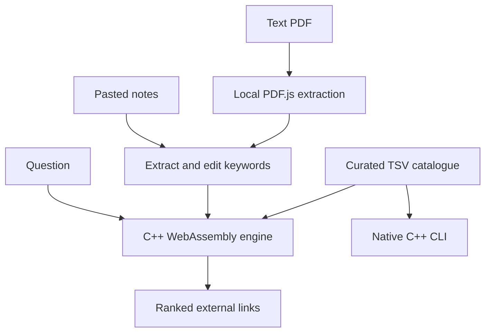

# Architecture and interview guide

## Mental model

An inverted index works like the index at the back of a textbook: a word points to the relevant entries. Instead of checking every resource, look up the word's posting list, then rank the matching entries.



## Data structures and validation

`Resource` stores ID, subject, title, URL, original description, keywords and source. A `vector<Resource>` holds the catalogue. Each word maps to `vector<Posting>`; postings store a document's vector position and term frequency. Document length and average length support BM25. Per-document frequency maps also support the full-scan benchmark.

The browser uses the same catalogue for display and receives resource IDs/scores from C++. There are no independently maintained catalogues. The loader validates field count, positive unique IDs, subjects and HTTPS URLs. It constructs a temporary engine before replacing the old one, so a bad reload preserves existing data. React renders input as text, not raw HTML.

## Text processing

1. Lowercase ASCII letters.
2. Split at punctuation and non-ASCII bytes, retaining digits and `+` for C++.
3. Apply explicit aliases such as `classes → class`, `deadlocks → deadlock`, `cpp → c++`.
4. Remove common words and tokens shorter than two characters.

This is deliberately not a Unicode tokenizer or a general stemmer. Variants absent from the dictionary can be missed. Indexing and querying use the same function. Query terms are deduplicated and sorted for deterministic accumulation order.

## BM25

```text
IDF(t) = ln(1 + (N - df(t) + 0.5) / (df(t) + 0.5))
contribution(t,d) = IDF(t) * tf(t,d) * (k1 + 1)
                   / (tf(t,d) + k1 * (1 - b + b * length(d) / averageLength))
score(d) = sum of contributions for distinct query words
k1 = 1.2; b = 0.75
```

`N` is catalogue size, `df` is the number of resources containing the word, and `tf` counts occurrences in title + description + keywords. Rare words contribute more. Repeated occurrences help with diminishing returns; length normalization prevents long descriptions dominating by default.

There is no separate title boost. Subject filtering restricts results while IDF remains based on the entire catalogue. A match on any query word can produce a result (OR retrieval). This is not exact-phrase or Boolean search. Ties use resource ID. Scores are not confidence percentages.

## Keyword extraction

Count words that occur in the catalogue vocabulary. Rank them by `(1 + ln(frequency)) * ln(1 + N/df)` and return at most 12, breaking ties alphabetically. Unknown concepts may be omitted by this step, so the interface allows keyword editing. Unknown query words contribute nothing.

## Complexity and fair comparison

Let T be indexed tokens, V vocabulary size, Q query terms, P visited postings and M matching documents. Expected construction is O(T), ignoring word lengths and hash collisions. Storage is O(T + V) plus text and the baseline's frequency maps.

Indexed scoring is expected O(P), followed by O(M log M) sorting. The full-scan baseline is expected O(QN) plus the same sorting. Both use precomputed frequencies; the baseline does not artificially repeat raw-text tokenization. Index construction and document extraction are excluded from query latency measurements.

## Native and WebAssembly

The same core compiles for both targets. A small bridge exports catalogue loading, last load error, search and keyword extraction. It serializes JSON but does not duplicate ranking. Returned strings belong to the module and are immediately copied by `ccall`; JavaScript must not free them. Emscripten manages runtime memory.

The frontend waits for asynchronous initialization and loads the generated module relative to its deployment location, including a GitHub Pages repository subpath. Generated Wasm is built in CI rather than committed to source.

## PDF processing

PDF.js extracts text locally using bundled worker/CMap/font assets. The application checks byte size, a PDF signature, page count and extracted character count, releases each page and destroys the loading task. Cancellation and switching modes abort the current loading task and discard stale results. Pasted notes remain in React state; extracted PDF text is used transiently for keywords.

Limits bound typical input processing, not every pathological file. There is no hard processing timeout. Cancel remains available while PDF work is in progress. Scanned pages require OCR elsewhere. The Node PDF smoke check verifies library-to-engine behavior, not full browser interaction or cancellation timing.

## Honest interview explanation

“I built a C++ lexical search engine over curated computer science resources. It creates an inverted index and ranks matches with BM25. The same core runs as a native CLI and through WebAssembly in React. PDF.js extracts document text locally; students edit keywords before searching. I checked scan/index parity and recorded benchmarks. The main limitations are catalogue coverage, English tokenization and lexical matching.”

Explain any development assistance honestly when asked. Do not claim production-scale usage, measured browser performance or independent authorship unless true.
